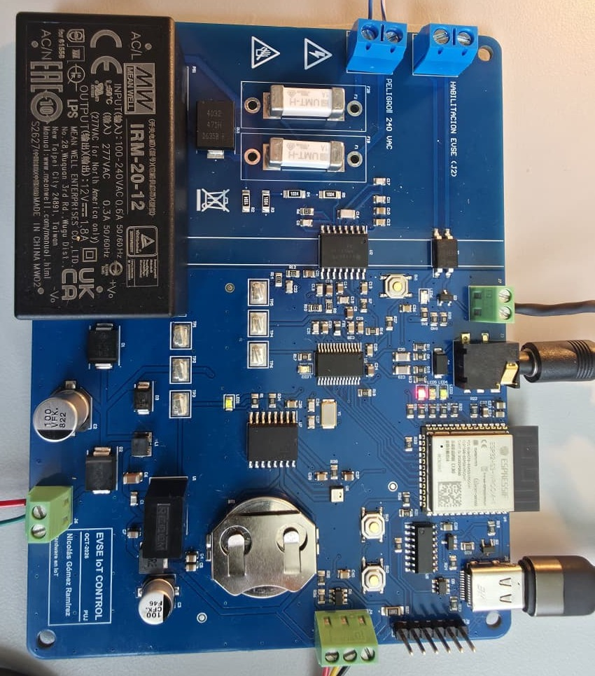
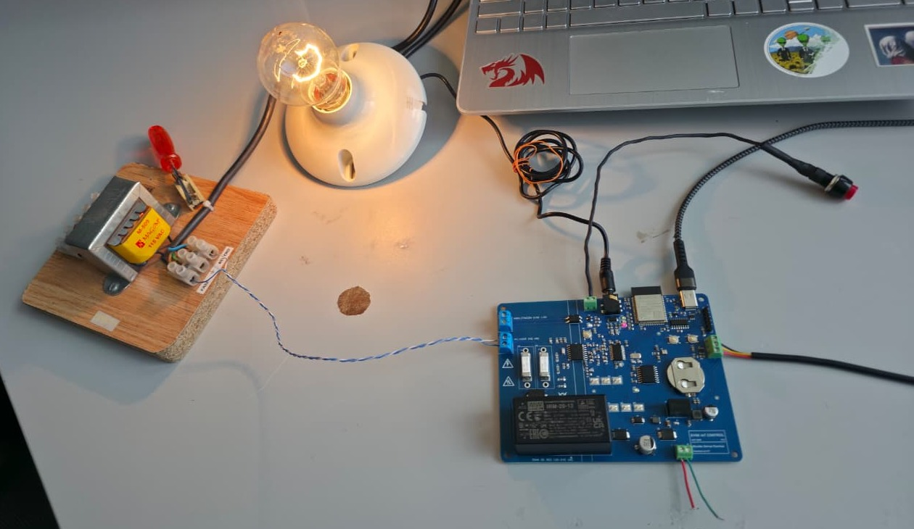
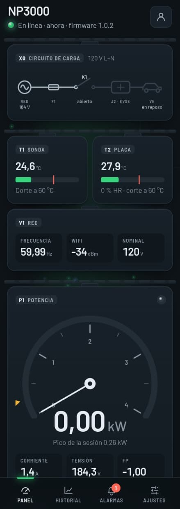
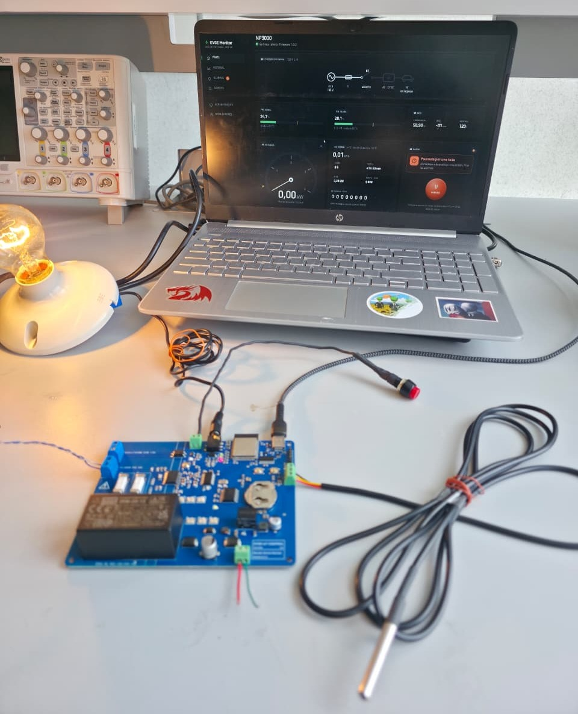
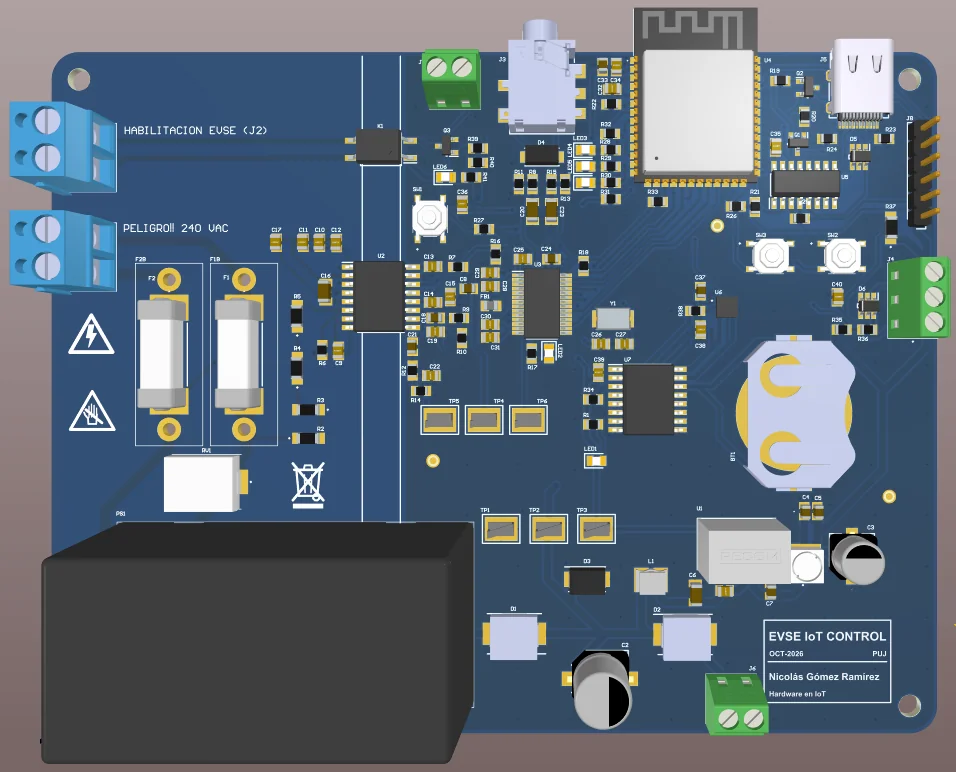
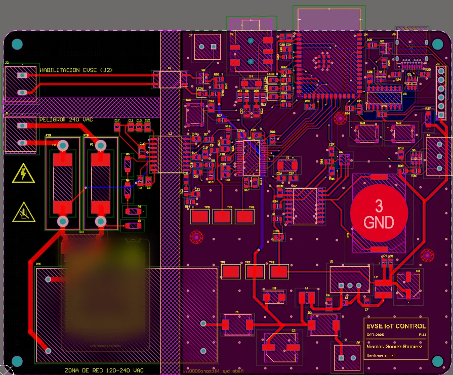
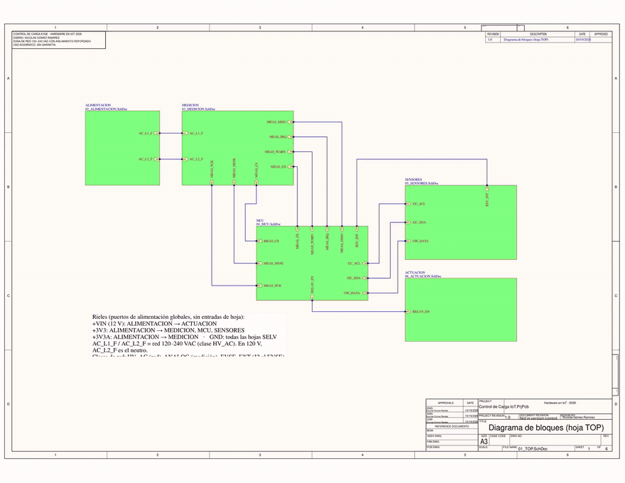
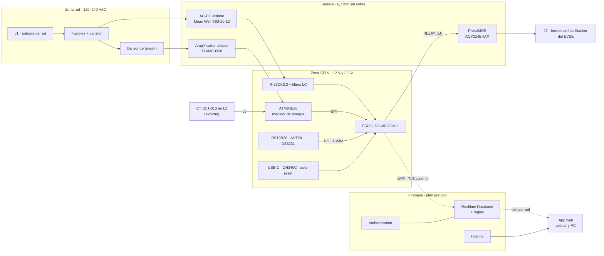

<div align="center">

# ⚡ Control de carga EVSE IoT

**Medidor y control IoT para el cargador de un carro eléctrico**

Mide cada carga, la habilita o la detiene y lo sube todo por WiFi a una app propia.

[](#estado)
[](https://youtu.be/911OGRqqaCk)
[](https://evse-monitor-d37rs.web.app)
[](altium/)
[](#componentes-principales)
[](#seguridad)
[](#la-placa)
[](https://nicolasgomez.dev/#hw-evse)



<sub>La placa 1 en el banco. Arriba, la zona de red con los fusibles; en el centro, la barrera de aislamiento; abajo, el lado de baja tensión con el ESP32-S3.</sub>

### [▶ Mira el video del proyecto](https://youtu.be/911OGRqqaCk)

</div>

> [!NOTE]
> **Funcionando en el banco.** La placa 1 corre el firmware 1.0.3 y se controla desde la app publicada en Firebase,
> en el celular y en el computador. Ya se probó alimentada desde la red (a través de un transformador de
> aislamiento) midiendo un bombillo, con pausa, reanudación y parada de emergencia desde la app y actualizaciones de
> firmware por internet. **Falta calibrar el medidor** (hoy la tensión se lee alta, ≈ 1,56 veces la real) y la prueba de
> punta a punta sin internet. El plan está en [`NEXT_SESSION.md`](NEXT_SESSION.md).

## Qué es

Una placa que se instala junto al cargador (EVSE) de un carro eléctrico. Mide tensión, corriente, potencia, energía
y temperatura durante la carga, la habilita o la detiene abriendo los bornes de habilitación del cargador y envía
todo por WiFi a una app propia, desde donde también llegan las órdenes.

Trabaja en 120 V monofásico (L–N) y en 240 V bifásico (L1–L2), así que una parte de la placa vive conectada a la
red eléctrica y la otra a 3,3 V, al alcance de un cable USB. Casi todo el diseño gira alrededor de esa frontera.

## Funcionando

<table>
  <tr>
    <td width="58%"></td>
    <td width="42%" rowspan="2" align="center"></td>
  </tr>
  <tr>
    <td><sub><b>Con la red.</b> La placa se alimenta de la red a través de un transformador de aislamiento 110:110 V y mide un bombillo de prueba.</sub></td>
  </tr>
  <tr>
    <td></td>
    <td><sub><b>La app en el celular</b> (captura real, antes de calibrar: por eso la tensión sale en 184 V). Arriba, el circuito de carga con K1; luego la sonda, la placa, la red y el medidor de potencia.<br><br><b>A la izquierda, el sistema completo:</b> placa, sonda DS18B20, botón de parada de emergencia en J7 y la app abierta en el computador.</sub></td>
  </tr>
</table>

## En cifras

| | |
|---|---|
| 🔌 Entrada | 100–264 VAC, en 120 V L–N o en 240 V L1–L2 |
| 📈 Mide | tensión, corriente, potencia, energía, frecuencia y temperatura |
| 🧠 Cerebro | ESP32-S3 con WiFi y 16 MB de flash |
| 🟩 Placa | 130 × 100 mm, 2 capas, FR-4 de 1,6 mm, cobre de 1 oz y HASL sin plomo |
| 🛡️ Barrera | 6,7 mm sin cobre entre la red y el lado de baja tensión |
| 🧩 Piezas | 58 referencias, 127 piezas por placa, casi todas soldadas por JLCPCB |
| 💾 Software | firmware de unas 4.000 líneas de C++ y app web de unas 3.000 líneas, sin framework |
| ✅ Pruebas | H0–H6 de hardware y S1–S6 con firmware aprobadas; red por transformador de aislamiento; 2 actualizaciones OTA |
| 🗓️ Tiempo | del 6 oct al 27 nov de 2026: de la primera hoja del esquemático al sistema funcionando |

## Qué tiene de interesante

- **Medición directa sobre la red, con aislamiento reforzado.** La tensión entra por un divisor resistivo y un
  amplificador aislado TI AMC3330. La corriente, por un transformador de núcleo partido que se abraza a L1 sin
  cortar el cable. Las dos llegan a un ATM90E26, un medidor de energía monofásico que entrega los resultados por SPI.
- **Sin contactor.** La placa no corta la potencia. Un PhotoMOS Panasonic con aislamiento reforzado de
  5000 Vrms abre o cierra los bornes de habilitación del EVSE y el cargador hace el resto. La Rev 1.0 lleva el
  AQY214EHAX (normalmente abierto), porque el AQY414EHAX (normalmente cerrado) no estaba en stock; usan la misma huella.
- **Tres zonas que no se tocan.** Zona de red, isla del EVSE y lado SELV, separadas por una franja sin cobre
  en ninguna capa. Solo la cruzan las tres piezas hechas para eso, la fuente AC-DC aislada, el AMC3330 y el PhotoMOS.
- **Las protecciones no dependen de internet.** El corte por temperatura, el botón de parada, las fallas, los límites
  y el horario se deciden en la ESP32-S3. Si se cae el WiFi, las mediciones se guardan en un búfer de 7 MB en la flash
  y se suben al volver. Un RTC con pila (DS3231) fecha todo aunque se vaya la luz.
- **Conexión saliente cifrada, sin servidor propio.** La ESP32 entra a Firebase con su propia cuenta, sube los datos y
  escucha sus órdenes por una conexión TLS que abre ella misma: sin VPN, sin puertos abiertos en la casa.
- **Ninguna orden se da por hecha.** En la app, «Pausar» o «Reanudar» muestra el recorrido App → Nube → Placa → K1 y
  espera a que la placa confirme que el relé cambió.
- **Se actualiza por internet.** El firmware nuevo se sube a la base en partes y la placa lo instala en unos 70 s,
  con vuelta atrás si no arranca. Así llegaron a la placa el 1.0.2 y el 1.0.3.
- **Pensada para fabricar.** SMD comunes en la cara superior para que JLCPCB los ensamble, y cada componente elegido
  comparando 2 o 3 opciones contra su datasheet y el stock real.
- **Revisada con scripts propios.** 58 scripts en Python leen los `.SchDoc` y el `.PcbDoc` de Altium para
  revisar redes, clases, reglas y ruteo, y comparan los Gerber contra la PCB antes de mandarlos a fabricar.

## La placa

<table>
  <tr>
    <td width="50%"></td>
    <td width="50%"></td>
  </tr>
  <tr>
    <td><sub>Render 3D en Altium. A la izquierda la zona de red, en el centro la barrera de aislamiento y a la derecha el lado de baja tensión.</sub></td>
    <td><sub>Layout 2D en Altium. La franja rayada vertical es la barrera de aislamiento.</sub></td>
  </tr>
  <tr>
    <td colspan="2" align="center"><br><sub>Las seis hojas del esquemático jerárquico, una tras otra.</sub></td>
  </tr>
</table>

Por qué quedó así, con las distancias, los planos de tierra y lo que se dejó por fuera, está explicado paso a paso
en [`docs/EXPLICACION_PCB_F8.md`](docs/EXPLICACION_PCB_F8.md). Hay una versión corta en Word en
[`docs/Descripcion_PCB_EVSE_Monitor.docx`](docs/Descripcion_PCB_EVSE_Monitor.docx).

## Arquitectura



## Componentes principales

| Bloque | Pieza | Qué hace |
|---|---|---|
| Microcontrolador | Espressif ESP32-S3-WROOM-1-N16R2 | WiFi, control, protecciones locales y búfer sin internet en sus 16 MB de flash |
| Medición | Microchip ATM90E26 | Tensión, corriente, potencia y energía, por SPI |
| Tensión aislada | TI AMC3330 + divisor resistivo | Lleva la tensión de red al lado de baja tensión a través de la barrera |
| Corriente | YHDC SCT-013 + jack de 3,5 mm | Transformador de corriente de núcleo partido, sin tocar el cableado |
| Alimentación | Mean Well IRM-20-12 + RECOM R-78CK3.3-0.5 | 12 V aislados de la red y 3,3 V con filtro LC (y un riel analógico aparte) |
| Actuación | Panasonic AQY214EHAX + AO3400A | Contacto seco aislado hacia los bornes de habilitación del EVSE |
| Sensores | DS18B20 · AHT20 · DS3231 | Sonda de temperatura, temperatura y humedad del ambiente, y reloj con pila |
| Programación | USB-C + WCH CH340C + auto-reset con dos NPN | Se programa sin tocar botones |

La lista completa, con las alternativas comparadas, el proveedor y la forma de montaje de cada pieza, está en
[`docs/DECISIONES.md`](docs/DECISIONES.md) y en [`docs/BOM_F7.md`](docs/BOM_F7.md).

## Seguridad

- Entrada de 100–264 VAC. Las distancias se calculan para el peor caso.
- Aislamiento reforzado entre la red y el lado SELV, con creepage ≥ 6,4 mm y clearance ≥ 5,5 mm. Entre L1 y L2,
  ≥ 3,2 mm.
- Nada del lado SELV (USB, sensores, conectores accesibles) se referencia a la red.
- Solo cruzan la barrera piezas especificadas para eso, el módulo AC-DC aislado, el AMC3330 y el PhotoMOS.
- Los bornes del EVSE se tratan como un circuito externo de potencial desconocido, con el mismo aislamiento
  reforzado hacia el lado SELV.
- En el banco, con la PCB desnuda, la red siempre llega a través de un transformador de aislamiento 1:1
  (D36); el producto terminado irá dentro de un gabinete (Rev 1.1).

## Software

| Parte | Dónde | Qué hace |
|---|---|---|
| Firmware de pruebas | [`firmware/prueba_placa/`](firmware/prueba_placa/) | Menú por consola para las pruebas S1–S6 de la placa, un comando por bloque |
| Firmware final | [`firmware/evse_monitor/`](firmware/evse_monitor/) | Medición, energía, sesiones, protecciones locales (temperatura, PARAR, fallas, tensión baja, límites, horario), K1, búfer de 7 MB sin internet, Firebase con TLS, portal de configuración, OTA por partes y avisos por Telegram. En la placa: 1.0.3 |
| App y base de datos | [`app/`](app/) | Firebase en el plan gratis (Authentication, Realtime Database con reglas de seguridad y Hosting). App web en español con diseño de tablero eléctrico, publicada en <https://evse-monitor-d37rs.web.app> (pide cuenta). Panel en vivo con el circuito de carga y un pulsador que espera la confirmación del equipo, historial con costos y CSV, anunciador de alarmas que dice qué pasa y qué hacer, ajustes, usuarios y OTA. Se instala en el celular (PWA, también en iPhone) |
| Simulador | [`tools/simulador/`](tools/simulador/) | Hace las mismas llamadas a Firebase que el firmware, para probar la app sin la placa (con el emulador local o con el proyecto real) |

El ESP32 entra a Firebase con su propia cuenta, escucha sus órdenes por una conexión saliente cifrada y sube los
datos: sin puertos abiertos, sin VPN y sin servidor propio. Las protecciones se deciden en el ESP32 y funcionan sin
internet. Cómo está hecho: [`ARQUITECTURA.md`](docs/software/ARQUITECTURA.md) · protocolo:
[`PROTOCOLO_MENSAJES.md`](docs/software/PROTOCOLO_MENSAJES.md) · cómo subirlo a la placa, publicar la app y actualizar
por OTA: [`GUIA_INSTALACION.md`](docs/software/GUIA_INSTALACION.md) · diseño de la app: [`DESIGN.md`](DESIGN.md).

## Estado

| Fase | En Altium | Qué se diseña | Estado |
|---|---|---|---|
| F1 | `01_TOP` | Estructura jerárquica e interfaces entre bloques | ✅ 7 oct |
| F2 | `02_ALIMENTACION` | Entrada de red, protección, AC-DC, rieles de 12 V y 3,3 V | ✅ 8 oct |
| F3 | `03_MEDICION` | Divisor, AMC3330, entrada del CT y ATM90E26 | ✅ 9 oct |
| F4 | `04_MCU` | ESP32-S3, USB-C, puente USB-UART, auto-reset y LEDs | ✅ 12 oct |
| F5 | `05_SENSORES` | DS18B20, AHT20 y RTC con pila | ✅ 12 oct |
| F6 | `06_ACTUACION` | Driver y PhotoMOS hacia el EVSE | ✅ 12 oct |
| F7 | todas | Compilación, footprints, clases de red y BOM con proveedores | ✅ 19 oct |
| F8 | `EVSE_Monitor.PcbDoc` | Contorno, reglas de aislamiento, ubicación, ruteo, DRC y archivos de fabricación | ✅ 22 oct |
| F9 | pedido y banco de pruebas | Pedido a JLCPCB, montaje, soldadura a mano y pruebas H0–H6 y S1–S6 | ✅ 24 nov (etiqueta `rev1.0`) |
| F10 | `firmware/` y `app/` | Firmware del ESP32-S3, app web en Firebase e integración con la placa | 🔧 app publicada, placa en línea con red y OTA; falta calibrar (S7) y S8 |

El esquemático completo está en [`docs/revisiones/PROYECTO_F7.pdf`](docs/revisiones/PROYECTO_F7.pdf). El detalle de
cada fase, con sus tareas, está en [`docs/PLAN_FASES.md`](docs/PLAN_FASES.md); las pruebas, con su registro, en
[`docs/pruebas/PROTOCOLO_PRUEBAS.md`](docs/pruebas/PROTOCOLO_PRUEBAS.md), y lo que sigue, en
[`NEXT_SESSION.md`](NEXT_SESSION.md).

## Fabricación

Todo lo que necesita JLCPCB está en [`docs/fabricacion/`](docs/fabricacion/). El pedido pasó de PCBWay a JLCPCB el 30 oct 2026 (D20): la PCB es la misma y cambió la BOM. Las dos placas llegaron ensambladas el 20 nov; a mano solo se soldaron U1 (R-78CK3.3-0.5) y los pulsadores SW2/SW3.

| Archivo | Para qué |
|---|---|
| `EVSE_Monitor_Gerber.zip` | Gerber y taladros de la placa |
| `BOM_JLC.csv` | Lista de materiales con los códigos de JLC/LCSC |
| `CPL_JLC.csv` | Posición y rotación de cada pieza |
| `Ensamble_EVSE_Monitor.pdf` | Plano de ensamble |
| `GUIA_PEDIDO_JLC.md` | El pedido paso a paso, campo por campo |
| `GUIA_PEDIDO.md`, `PEDIDO_PCBWAY.md`, `*_PCBWay.*` | El pedido de PCBWay (historia) |

Las vistas de cada capa de los Gerber, tal como deben verse en el visor del fabricante, están en
[`docs/revisiones/gerber/`](docs/revisiones/gerber/). El modelo STEP pesa 20 MB y se regenera con el OutJob.

## Estructura del repositorio

```
├── CLAUDE.md                 reglas de trabajo del proyecto
├── NEXT_SESSION.md           plan de la fase en curso
├── PRODUCT.md, DESIGN.md     para quién es la app y su sistema visual
├── altium/                   proyecto de Altium Designer (.PrjPcb, hojas, PCB, OutJob, plantilla y librerías)
├── firmware/                 PlatformIO: prueba_placa (S1–S6) y evse_monitor (firmware final)
├── app/                      app web y reglas de Firebase (Authentication, Realtime Database, Hosting)
├── tools/simulador/          simulador del equipo
└── docs/
    ├── PLAN_FASES.md         las 10 fases, con sus tareas y el mapa de bloques
    ├── DECISIONES.md         registro de decisiones (D1–D37) y componentes elegidos
    ├── BOM_F7.md             BOM con proveedor y montaje de cada línea
    ├── GUIA_RUTEO_F8.md      distribución, distancias, anchos y reglas de la PCB
    ├── EXPLICACION_PCB_F8.md por qué la PCB quedó así
    ├── calculos/             cálculos de alimentación y medición
    ├── esquemas/             esquemas por bloque, tal como se dibujan en Altium
    ├── fabricacion/          paquete para JLCPCB y carrito de compras
    ├── fotos/                fotos de la placa funcionando y capturas de la app
    ├── img/                  render, layout y esquemático de este README
    ├── pruebas/              protocolo de pruebas de la placa, registro y mapa de 39 puntos
    ├── revisiones/           PDF del esquemático por fase, capturas de la PCB y vistas de los Gerber
    ├── software/             arquitectura, protocolo de mensajes y guía de instalación
    ├── sesiones/             resumen de cada fase cerrada
    └── tools/                scripts en Python que leen, revisan y editan los archivos de Altium
```

## Abrir el proyecto

`altium/` se abre directo en Altium Designer 25 (las rutas del proyecto son relativas). Es un espejo del proyecto de
trabajo, que vive en otra carpeta, y se actualiza al cierre de cada sesión con
`python docs/tools/sincronizar_altium.py --commit`.

---

<div align="center">

**Nicolás Gómez Ramírez** · Ingeniería Electrónica, Pontificia Universidad Javeriana · Hardware en IoT, 2026

[▶ Video](https://youtu.be/911OGRqqaCk) · [nicolasgomez.dev](https://nicolasgomez.dev) · [LinkedIn](https://www.linkedin.com/in/nicolas-gomez-elec)

</div>
