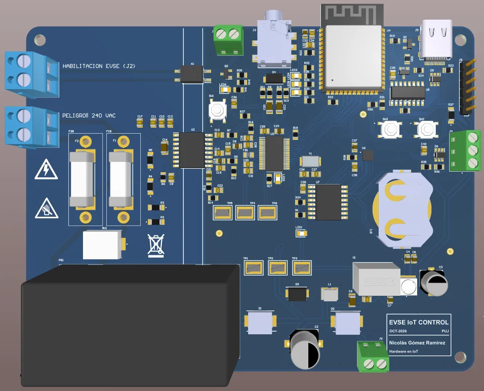
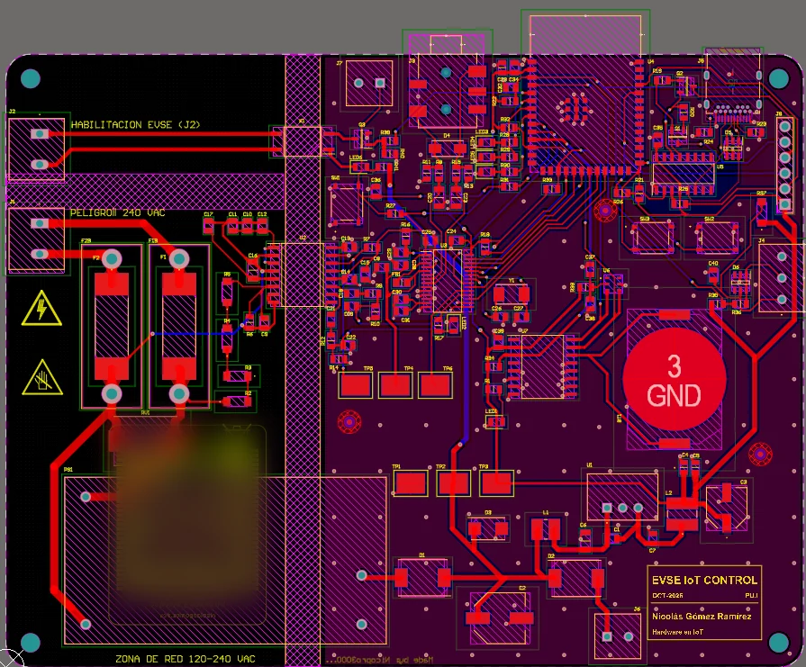
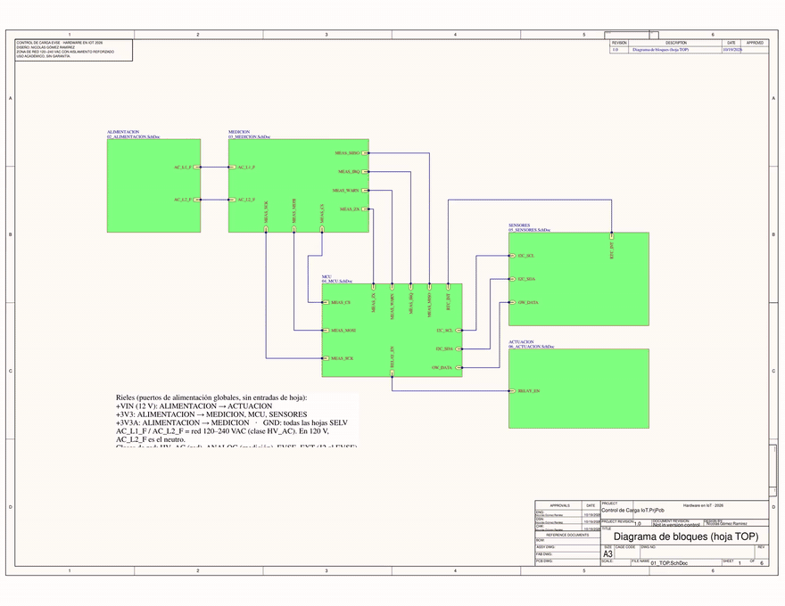
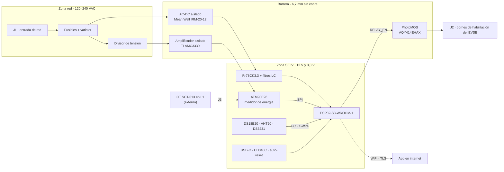

<div align="center">

# ⚡ Control de carga EVSE IoT

**Medidor y control IoT para el cargador de un carro eléctrico**

Mide cada carga, la habilita o la detiene y lo sube todo por WiFi a una app propia.

[](#estado)
[](altium/)
[](#componentes-principales)
[](#seguridad)
[](#la-placa)
[](docs/EXPLICACION_PCB_F8.md)
[](https://nicolasgomez.dev/#hw-evse)



<sub>Render 3D de la placa. A la izquierda la zona de red, en el centro la barrera de aislamiento y a la derecha el lado de baja tensión.</sub>

</div>

> [!NOTE]
> **En proceso.** El esquemático y la PCB están cerrados y revisados (fases 1 a 8). Sigue el pedido a PCBWay, el
> montaje y las primeras pruebas. Las fotos de la placa real llegan cuando exista.

## Qué es

Una placa que se instala junto al cargador (EVSE) de un carro eléctrico. Mide tensión, corriente, potencia, energía
y temperatura durante la carga, la habilita o la detiene abriendo los bornes de habilitación del cargador y envía
todo por WiFi a una app propia, desde donde también llegan las órdenes.

Trabaja en 120 V monofásico (L–N) y en 240 V bifásico (L1–L2), así que una parte de la placa vive conectada a la
red eléctrica y la otra a 3,3 V, al alcance de un cable USB. Casi todo el diseño gira alrededor de esa frontera.

## En cifras

| | |
|---|---|
| 🔌 Entrada | 100–264 VAC, en 120 V L–N o en 240 V L1–L2 |
| 📈 Mide | tensión, corriente, potencia, energía y temperatura |
| 🧠 Cerebro | ESP32-S3 con WiFi y 16 MB de flash |
| 🟩 Placa | 130 × 100 mm, 2 capas, FR-4 de 1,6 mm, cobre de 1 oz y HASL sin plomo |
| 🛡️ Barrera | 6,7 mm sin cobre entre la red y el lado de baja tensión |
| 🧩 Piezas | 58 referencias (119 SMD y 8 THT), casi todas soldadas por PCBWay |
| ✅ Revisión | DRC con 0 violaciones eléctricas y Gerber comparados contra la PCB, taladro por taladro (304) |

## Qué tiene de interesante

- **Medición directa sobre la red, con aislamiento reforzado.** La tensión entra por un divisor resistivo y un
  amplificador aislado TI AMC3330. La corriente, por un transformador de núcleo partido que se abraza a L1 sin
  cortar el cable. Las dos llegan a un ATM90E26, un medidor de energía monofásico que entrega los resultados por SPI.
- **Sin contactor.** La placa no corta la potencia. Un PhotoMOS Panasonic AQY414EHAX (normalmente cerrado,
  5000 Vrms) abre los bornes de habilitación del EVSE y el cargador hace el resto.
- **Tres zonas que no se tocan.** Zona de red, isla del EVSE y lado SELV, separadas por una franja vertical sin cobre
  en ninguna capa. Solo la cruzan las tres piezas hechas para eso, la fuente AC-DC aislada, el AMC3330 y el PhotoMOS.
- **Las protecciones no dependen de internet.** El corte por temperatura y por fallas se decide en la ESP32-S3.
  Si se cae el WiFi, las mediciones se guardan en la flash y la energía de la sesión queda en NVS cada minuto.
  Un RTC con pila (DS3231) fecha todo aunque se vaya la luz.
- **Conexión saliente cifrada.** La ESP32 abre una conexión TLS hacia el servidor de la app, sube los datos y recibe
  las órdenes por ahí mismo. Sin VPN ni puertos abiertos en la casa.
- **Pensada para fabricar.** SMD comunes en la cara superior para que PCBWay los ensamble, y cada componente elegido
  comparando 2 o 3 opciones contra su datasheet y el stock real.
- **Revisada con scripts propios.** Más de 50 scripts en Python leen los `.SchDoc` y el `.PcbDoc` de Altium para
  revisar redes, clases, reglas y ruteo, y comparan los Gerber contra la PCB antes de mandarlos a fabricar.

## La placa

<table>
  <tr>
    <td width="50%"></td>
    <td width="50%"></td>
  </tr>
  <tr>
    <td><sub>Layout 2D en Altium. La franja rayada vertical es la barrera de aislamiento.</sub></td>
    <td><sub>Las seis hojas del esquemático jerárquico, una tras otra.</sub></td>
  </tr>
</table>

Por qué quedó así, con las distancias, los planos de tierra y lo que se dejó por fuera, está explicado paso a paso
en [`docs/EXPLICACION_PCB_F8.md`](docs/EXPLICACION_PCB_F8.md). Hay una versión corta en Word en
[`docs/Descripcion_PCB_EVSE_Monitor.docx`](docs/Descripcion_PCB_EVSE_Monitor.docx).

## Arquitectura



## Componentes principales

| Bloque | Pieza | Qué hace |
|---|---|---|
| Microcontrolador | Espressif ESP32-S3-WROOM-1-N16R2 | WiFi, control, protecciones locales y búfer sin internet en sus 16 MB de flash |
| Medición | Microchip ATM90E26 | Tensión, corriente, potencia y energía, por SPI |
| Tensión aislada | TI AMC3330 + divisor resistivo | Lleva la tensión de red al lado de baja tensión a través de la barrera |
| Corriente | YHDC SCT-013 + jack de 3,5 mm | Transformador de corriente de núcleo partido, sin tocar el cableado |
| Alimentación | Mean Well IRM-20-12 + RECOM R-78CK3.3-0.5 | 12 V aislados de la red y 3,3 V con filtro LC (y un riel analógico aparte) |
| Actuación | Panasonic AQY414EHAX + AO3400A | Contacto seco aislado hacia los bornes de habilitación del EVSE |
| Sensores | DS18B20 · AHT20 · DS3231 | Sonda de temperatura, temperatura y humedad del ambiente, y reloj con pila |
| Programación | USB-C + WCH CH340C + auto-reset con dos NPN | Se programa sin tocar botones |

La lista completa, con las alternativas comparadas, el proveedor y la forma de montaje de cada pieza, está en
[`docs/DECISIONES.md`](docs/DECISIONES.md) y en [`docs/BOM_F7.md`](docs/BOM_F7.md).

## Seguridad

- Entrada de 100–264 VAC. Las distancias se calculan para el peor caso.
- Aislamiento reforzado entre la red y el lado SELV, con creepage ≥ 6,4 mm y clearance ≥ 5,5 mm. Entre L1 y L2,
  ≥ 3,2 mm.
- Nada del lado SELV (USB, sensores, conectores accesibles) se referencia a la red.
- Solo cruzan la barrera piezas especificadas para eso, el módulo AC-DC aislado, el AMC3330 y el PhotoMOS.
- Los bornes del EVSE se tratan como un circuito externo de potencial desconocido, con el mismo aislamiento
  reforzado hacia el lado SELV.

## Estado

| Fase | En Altium | Qué se diseña | Estado |
|---|---|---|---|
| F1 | `01_TOP` | Estructura jerárquica e interfaces entre bloques | ✅ |
| F2 | `02_ALIMENTACION` | Entrada de red, protección, AC-DC, rieles de 12 V y 3,3 V | ✅ |
| F3 | `03_MEDICION` | Divisor, AMC3330, entrada del CT y ATM90E26 | ✅ |
| F4 | `04_MCU` | ESP32-S3, USB-C, puente USB-UART, auto-reset y LEDs | ✅ |
| F5 | `05_SENSORES` | DS18B20, AHT20 y RTC con pila | ✅ |
| F6 | `06_ACTUACION` | Driver y PhotoMOS hacia el EVSE | ✅ |
| F7 | todas | Compilación, footprints, clases de red y BOM con proveedores | ✅ |
| F8 | `EVSE_Monitor.PcbDoc` | Contorno, reglas de aislamiento, ubicación, ruteo, DRC y archivos para PCBWay | ✅ |
| F9 | pedido y banco de pruebas | Pedido a PCBWay, montaje, soldadura a mano y pruebas por etapas | 🔧 en curso |

El esquemático completo está en [`docs/revisiones/PROYECTO_F7.pdf`](docs/revisiones/PROYECTO_F7.pdf). El detalle de
cada fase, con sus tareas, está en [`docs/PLAN_FASES.md`](docs/PLAN_FASES.md), y lo que sigue, en
[`NEXT_SESSION.md`](NEXT_SESSION.md).

## Fabricación

Todo lo que necesita PCBWay está en [`docs/fabricacion/`](docs/fabricacion/).

| Archivo | Para qué |
|---|---|
| `EVSE_Monitor_Gerber.zip` | Gerber y taladros de la placa |
| `BOM_PCBWay.xlsx` | Lista de materiales para el ensamble turnkey |
| `PickPlace_PCBWay.csv` | Posición y rotación de cada pieza |
| `Ensamble_EVSE_Monitor.pdf` | Plano de ensamble |
| `GUIA_PEDIDO.md` | El pedido paso a paso, campo por campo |
| `PEDIDO_PCBWAY.md` | Las notas en inglés para el pedido |

Las vistas de cada capa de los Gerber, tal como deben verse en el visor de PCBWay, están en
[`docs/revisiones/gerber/`](docs/revisiones/gerber/). El modelo STEP pesa 20 MB y se regenera con el OutJob.

## Estructura del repositorio

```
├── CLAUDE.md                 reglas de trabajo del proyecto
├── NEXT_SESSION.md           plan de la fase en curso
├── altium/                   proyecto de Altium Designer (.PrjPcb, hojas, PCB, OutJob, plantilla y librerías)
└── docs/
    ├── PLAN_FASES.md         las 9 fases, con sus tareas y el mapa de bloques
    ├── DECISIONES.md         registro de decisiones (D1–D19) y componentes elegidos
    ├── BOM_F7.md             BOM con proveedor y montaje de cada línea
    ├── GUIA_RUTEO_F8.md      distribución, distancias, anchos y reglas de la PCB
    ├── EXPLICACION_PCB_F8.md por qué la PCB quedó así
    ├── calculos/             cálculos de alimentación y medición
    ├── esquemas/             esquemas por bloque, tal como se dibujan en Altium
    ├── fabricacion/          paquete para PCBWay y carrito de compras
    ├── img/                  imágenes de este README
    ├── revisiones/           PDF del esquemático por fase, capturas de la PCB y vistas de los Gerber
    ├── sesiones/             resumen de cada fase cerrada
    └── tools/                scripts en Python que leen, revisan y editan los archivos de Altium
```

## Abrir el proyecto

`altium/` se abre directo en Altium Designer 25 (las rutas del proyecto son relativas). Es un espejo del proyecto de
trabajo, que vive en otra carpeta, y se actualiza al cierre de cada sesión con
`python docs/tools/sincronizar_altium.py --commit`.

---

<div align="center">

**Nicolás Gómez** · Ingeniería Electrónica, Pontificia Universidad Javeriana

[nicolasgomez.dev](https://nicolasgomez.dev) · [LinkedIn](https://www.linkedin.com/in/nicolas-gomez-elec)

</div>
