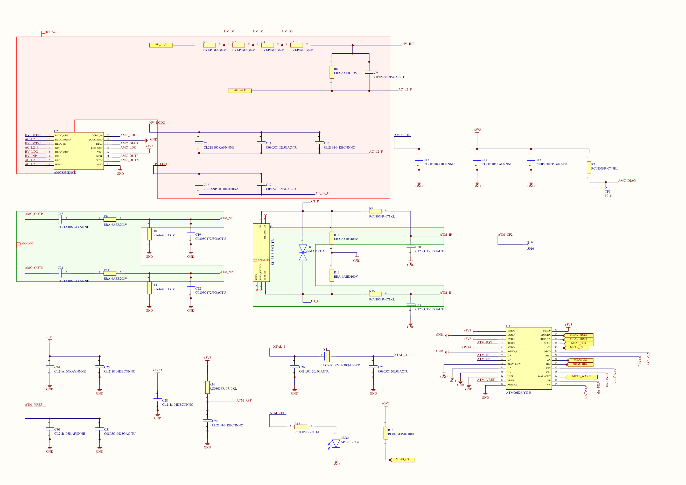
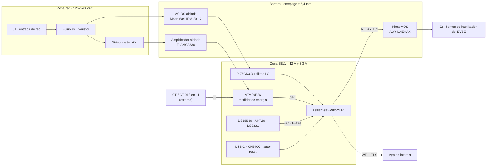

# Control de carga EVSE · medidor IoT para carro eléctrico

> 🚧 **En proceso.** El esquemático de las seis hojas está cerrado y revisado. Lo que sigue es la BOM con
> proveedores, el ruteo de la PCB y el pedido a PCBWay. Las fotos de la placa llegan cuando exista.

Una placa que se instala junto al cargador (EVSE) de un carro eléctrico. Mide tensión, corriente, potencia,
energía y temperatura durante la carga, la habilita o la detiene abriendo los bornes de habilitación del cargador
y envía todo por WiFi a una app propia, desde donde también llegan las órdenes.

Trabaja en 120 V monofásico (L–N) y en 240 V bifásico (L1–L2), así que una parte de la placa vive conectada a la
red eléctrica y la otra a 3,3 V, al alcance de un cable USB. Casi todo el diseño gira alrededor de esa frontera.



## Qué tiene de interesante

- **Medición directa sobre la red, con aislamiento reforzado.** La tensión entra por un divisor resistivo y un
  amplificador aislado TI AMC3330. La corriente, por un transformador de núcleo partido que se abraza a L1 sin
  cortar el cable. Las dos llegan a un ATM90E26, un medidor de energía monofásico que entrega los resultados por SPI.
- **Sin contactor.** La placa no corta la potencia. Un PhotoMOS Panasonic AQY414EHAX (normalmente cerrado,
  5000 Vrms) abre los bornes de habilitación del EVSE, y el cargador hace el resto.
- **Las protecciones no dependen de internet.** El corte por temperatura y por fallas se decide en la ESP32-S3.
  Si se cae el WiFi, las mediciones se guardan en la flash y la energía de la sesión queda en NVS cada minuto.
  Un RTC con pila (DS3231) fecha todo aunque se vaya la luz.
- **Conexión saliente cifrada.** La ESP32 abre una conexión TLS hacia el servidor de la app, sube los datos y
  recibe las órdenes por ahí mismo. Sin VPN ni puertos abiertos en la casa.
- **Pensada para fabricar.** SMD comunes en la cara superior para que PCBWay los ensamble, lo demás agrupado para
  soldar a mano, y cada componente elegido comparando 2 o 3 opciones contra su datasheet y el stock real.

## Arquitectura



## Componentes principales

| Bloque | Pieza | Qué hace |
|---|---|---|
| Microcontrolador | Espressif ESP32-S3-WROOM-1-N16R2 | WiFi, control, protecciones locales y búfer sin internet en sus 16 MB de flash |
| Medición | Microchip ATM90E26 | Tensión, corriente, potencia y energía, por SPI |
| Tensión aislada | TI AMC3330 + divisor resistivo | Lleva la tensión de red al lado de baja tensión a través de la barrera |
| Corriente | YHDC SCT-013 + jack de 3,5 mm | Transformador de corriente de núcleo partido, sin tocar el cableado |
| Alimentación | Mean Well IRM-20-12 + RECOM R-78CK3.3-0.5 | 12 V aislados de la red y 3,3 V con filtro LC (y un riel analógico aparte) |
| Actuación | Panasonic AQY414EHAX + AO3400A | Contacto seco aislado hacia los bornes de habilitación del EVSE |
| Sensores | DS18B20 · AHT20 · DS3231 | Sonda de temperatura, temperatura y humedad del ambiente, y reloj con pila |
| Programación | USB-C + WCH CH340C + auto-reset con dos NPN | Se programa sin tocar botones |

La lista completa, con las alternativas comparadas, proveedor y forma de montaje de cada pieza, está en
[`docs/DECISIONES.md`](docs/DECISIONES.md).

## Seguridad

- Entrada de 100–264 VAC. Las distancias se calculan para el peor caso.
- Aislamiento reforzado entre la red y el lado SELV, con creepage ≥ 6,4 mm y clearance ≥ 5,5 mm. Entre L1 y L2,
  ≥ 3,2 mm.
- Nada del lado SELV (USB, sensores, conectores accesibles) se referencia a la red.
- Solo cruzan la barrera piezas especificadas para eso: el módulo AC-DC aislado, el AMC3330 y el PhotoMOS.
- Los bornes del EVSE se tratan como un circuito externo de potencial desconocido, con el mismo aislamiento
  reforzado hacia el lado SELV.

## Estado

| Fase | Hoja de Altium | Qué se diseña | Estado |
|---|---|---|---|
| F1 | `01_TOP` | Estructura jerárquica e interfaces entre bloques | ✅ |
| F2 | `02_ALIMENTACION` | Entrada de red, protección, AC-DC, rieles de 12 V y 3,3 V | ✅ |
| F3 | `03_MEDICION` | Divisor, AMC3330, entrada del CT y ATM90E26 | ✅ |
| F4 | `04_MCU` | ESP32-S3, USB-C, puente USB-UART, auto-reset y LEDs | ✅ |
| F5 | `05_SENSORES` | DS18B20, AHT20 y RTC con pila | ✅ |
| F6 | `06_ACTUACION` | Driver y PhotoMOS hacia el EVSE | ✅ |
| F7 | todas | Compilación, footprints, BOM con proveedores y gabinete | 🔧 en curso |
| F8 | `EVSE_Monitor.PcbDoc` | Contorno, reglas de aislamiento, ruteo, DRC y pedido a PCBWay | pendiente |

El esquemático completo de la última fase cerrada está en
[`docs/revisiones/PROYECTO_F6.pdf`](docs/revisiones/PROYECTO_F6.pdf). El detalle de cada fase, con sus tareas,
está en [`docs/PLAN_FASES.md`](docs/PLAN_FASES.md).

## Estructura del repositorio

```
├── CLAUDE.md            reglas de trabajo del proyecto
├── NEXT_SESSION.md      plan de la fase en curso
└── docs/
    ├── PLAN_FASES.md    las 8 fases, con sus tareas y el mapa de bloques
    ├── DECISIONES.md    registro de decisiones (D1–D15) y componentes elegidos
    ├── calculos/        cálculos de alimentación y medición
    ├── esquemas/        esquemas por bloque, tal como se dibujan en Altium
    ├── revisiones/      PDF del esquemático al cierre de cada fase
    ├── sesiones/        resumen de cada fase cerrada
    └── tools/           scripts en Python que leen y revisan los .SchDoc y la librería de Altium
```

Los archivos fuente de Altium (`.PrjPcb`, `.SchDoc`, `.PcbDoc` y la librería) viven en una carpeta aparte.

---

Nicolás Gómez · Ingeniería Electrónica, Pontificia Universidad Javeriana ·
[nicolasgomez.dev](https://nicolasgomez.dev)
