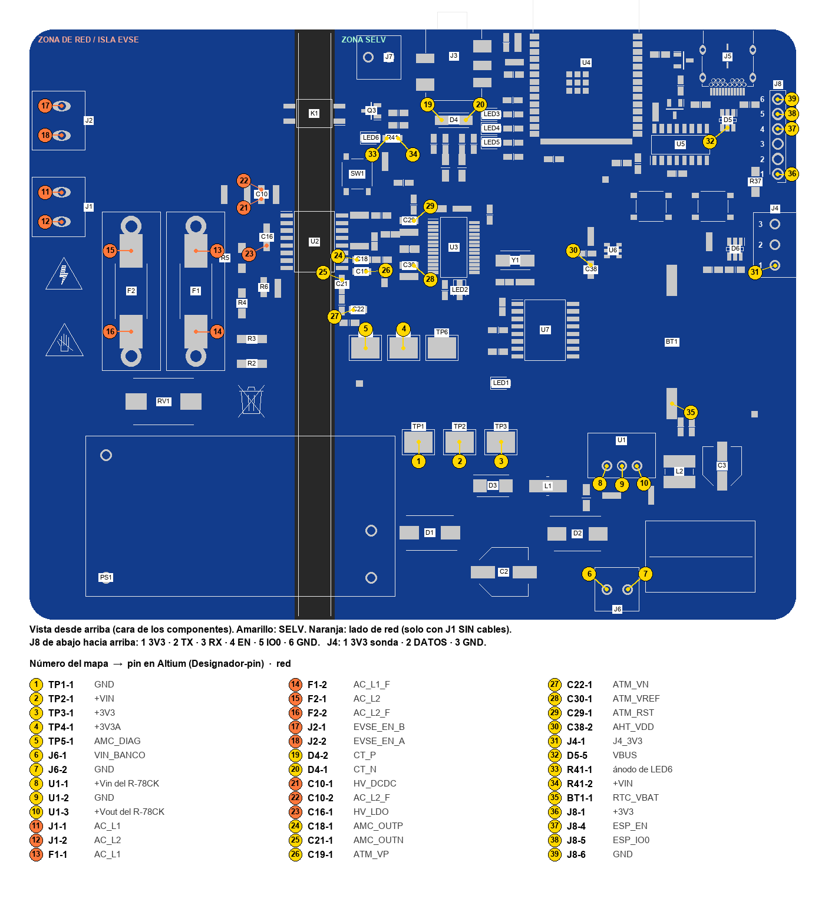

# Protocolo de pruebas — EVSE Monitor Rev 1.0

Fase 9C. Se prueba la **placa 1**. La placa 2 queda de repuesto: solo hay un R-78CK, pero se puede validar hasta H3 sin él. Una etapa a la vez. Si una medición sale del rango, **se para**, se anota y se revisa antes de seguir. Los valores esperados salen de las redes de las hojas 02–06, de `docs/calculos/` y de los datasheets de `docs/datasheets/`.

**Regla de oro:** hasta S7 la placa **nunca** se conecta a la red. J1 queda sin cables.

## Mapa de puntos

Cada medición se hace entre dos **puntos numerados** del mapa (los círculos amarillos y naranjas, del 1 al 39). Al lado de cada número va su pin en Altium, como **Designador-pin**. Por ejemplo, **7** (J6-2) es el pin 2 de J6, y en Altium es la misma pieza y el mismo pad. La placa se mira desde arriba, con J1 y J2 a la izquierda y el ESP32 arriba. El mapa sale de `docs/tools/mapa_puntos_f9.py`.



- Los puntos 1 a 5 son TP1 a TP5. Desde el 6, el número **no** es un TP: es otro pin, el que dice la tabla. TP6 (CF2) no se usa en estas pruebas.
- Los puntos naranjas (11 a 23) están en el lado de red: **solo se tocan con J1 sin cables**.
- **Para buscar un punto en Altium:** en el PCB, J → C (Jump → Component) y se escribe el designador. Al pasar el mouse sobre el pad sale «Pad J6-2» y su red.

| Nº | Altium | Red | Dónde está en la placa |
|---|---|---|---|
| 1 | TP1-1 | GND | TP1 |
| 2 | TP2-1 | +VIN | TP2 |
| 3 | TP3-1 | +3V3 | TP3 |
| 4 | TP4-1 | +3V3A | TP4 |
| 5 | TP5-1 | AMC_DIAG | TP5 |
| 6 | J6-1 | VIN_BANCO (+12 V de banco) | J6, tornillo izquierdo |
| 7 | J6-2 | GND | J6, tornillo derecho |
| 8 | U1-1 | +Vin del R-78CK | U1, pad cuadrado (izquierdo) |
| 9 | U1-2 | GND | U1, pad del medio |
| 10 | U1-3 | +Vout del R-78CK | U1, pad derecho |
| 11 | J1-1 | AC_L1 | J1, tornillo de arriba |
| 12 | J1-2 | AC_L2 | J1, tornillo de abajo |
| 13 | F1-1 | AC_L1 | F1, tapa de arriba |
| 14 | F1-2 | AC_L1_F | F1, tapa de abajo |
| 15 | F2-1 | AC_L2 | F2, tapa de arriba |
| 16 | F2-2 | AC_L2_F | F2, tapa de abajo |
| 17 | J2-1 | EVSE_EN_B | J2, tornillo de arriba |
| 18 | J2-2 | EVSE_EN_A | J2, tornillo de abajo |
| 19 | D4-2 | CT_P (punta del jack) | D4, extremo izquierdo |
| 20 | D4-1 | CT_N (camisa del jack) | D4, extremo derecho |
| 21 | C10-1 | HV_DCDC | C10, extremo de abajo |
| 22 | C10-2 | AC_L2_F (tierra del lado de red del AMC3330) | C10, extremo de arriba |
| 23 | C16-1 | HV_LDO | C16, extremo de abajo |
| 24 | C18-1 | AMC_OUTP | C18, extremo izquierdo |
| 25 | C21-1 | AMC_OUTN | C21, extremo de arriba |
| 26 | C19-1 | ATM_VP | C19, extremo derecho |
| 27 | C22-1 | ATM_VN | C22, extremo izquierdo |
| 28 | C30-1 | ATM_VREF | C30, extremo derecho |
| 29 | C29-1 | ATM_RST | C29, extremo derecho |
| 30 | C38-2 | AHT_VDD | C38, extremo de arriba |
| 31 | J4-1 | J4_3V3 (3,3 V de la sonda) | J4, tornillo de abajo |
| 32 | D5-5 | VBUS | D5, pata del medio de la fila de abajo |
| 33 | R41-1 | ánodo de LED6 | R41, extremo izquierdo |
| 34 | R41-2 | +VIN | R41, extremo derecho |
| 35 | BT1-1 | RTC_VBAT | BT1, pata de abajo |
| 36 | J8-1 | +3V3 | J8, pin de abajo |
| 37 | J8-4 | ESP_EN | J8, cuarto pin desde abajo |
| 38 | J8-5 | ESP_IO0 | J8, quinto pin desde abajo |
| 39 | J8-6 | GND | J8, pin de arriba |

Las resistencias del divisor se miden entre sus dos pads, que se nombran igual que en Altium: R2-1 y R2-2, R3-1 y R3-2, y así.

## Convenciones

- **Multímetro:** punta negra en COM y roja en V/Ω. «Ω» = resistencia; «diodo» = modo diodo (marca la caída directa en V); «V⎓» = tensión continua; «V~» = tensión alterna.
- En las tablas, las columnas **Roja** y **Negra** dicen en qué punto va cada punta. «**2** (TP2-1)» = punto 2 del mapa, que en Altium es el pin 1 de TP2.
- En los condensadores 0805 se toca el extremo metálico (el filete de soldadura), nunca dos patas a la vez. En U3, U5, D5 y J5, puntas finas o de aguja.
- En Ω, juntar primero las puntas y anotar lo que marcan (0,1–0,3 Ω): eso es el cable. «< 1 Ω» quiere decir casi lo mismo que con las puntas juntas.
- Para medir aislamiento no se tocan las puntas con los dedos: el cuerpo marca MΩ.
- **Fuente de banco:** con la salida apagada, se ajustan la tensión y el límite de corriente. Después se conectan los cables, se enciende y se lee la corriente. Si la fuente entra en límite (la tensión cae y se enciende el indicador CC), se apaga de inmediato.

## Ajuste del multímetro (Keysight 34461A)

| Para | Función del 34461A | Puntas | Notas |
|---|---|---|---|
| Resistencia (H1-1, H1-2, H1-3, H1-5, H1-6) | **Ω 2W**, rango automático | roja en HI, negra en LO | Antes de medir menos de 10 Ω: juntar las puntas y pulsar **Null** (resta el cable). Quitar el Null antes de medir aislamiento. Para MΩ, esperar a que la lectura se estabilice |
| Diodos (H1-4) | **Diode** | roja en HI (ánodo), negra en LO | Muestra la caída directa en V (hasta 5 V de escala, así que también prende los LEDs un poco). Abierto = indicación de sobrerrango |
| Tensión continua (H2, H3, H4, S) | **DCV**, rango automático | roja en HI, negra en LO | — |
| Tensión alterna (S5, S7) | **ACV**, rango automático | roja en HI, negra en LO | Valor eficaz verdadero |
| Corriente | no se usa: se lee en la fuente de banco | — | — |

En este protocolo, «OL» quiere decir que el 34461A indica sobrerrango o circuito abierto.

## Qué tener a mano

Multímetro con modo diodo y escala de MΩ · puntas finas o de aguja · pinzas tipo caimán o gancho para los TP · cables dupont hembra para J8 · fuente de banco con límite de corriente · lupa (o el zoom de la cámara del celular) · alcohol isopropílico y cepillo · cautín, estaño y flux para U1 · cable USB-C **de datos** · osciloscopio (opcional). Más adelante: CR2032, sonda DS18B20, CT, transformador de aislamiento, breaker o regleta con interruptor, carga resistiva conocida, pinza amperimétrica y generador de funciones (opcional).

---

## H0 · Inspección visual

### Revisión de las fotos del 20 nov (placa 1)

Comparada con el PcbDoc (qué pad es +, cátodo o pin 1 de cada pieza):

| Pieza | Qué tiene que verse | En la foto | Resultado |
|---|---|---|---|
| C2 (100 µF 35 V, «VFK») | franja negra (−, C2-2) a la **derecha** | a la derecha | ✓ |
| C3 (100 µF 16 V, «CFK») | franja negra (−, C3-2) **arriba** | arriba | ✓ |
| D1 (SS34) | banda (cátodo, D1-1) a la **derecha**, hacia +VIN | a la derecha | ✓ |
| D2 (SS34) | banda (D2-1) a la **izquierda**, hacia +VIN | a la izquierda | ✓ |
| D3 (SMBJ15A) | banda (D3-1) a la **izquierda**, hacia +VIN | no se distingue en la foto | se confirma en H1-4 |
| K1 (AQY214EH) | marca circular de pin 1 (K1-1) **abajo a la derecha**, lado SELV | abajo a la derecha | ✓ |
| U2 (AMC3330) | marca de pin 1 (U2-1) **arriba a la izquierda**, lado de red | arriba a la izquierda | ✓ |
| U3 (ATM90E26) | marca de pin 1 (U3-1) **arriba a la izquierda** | arriba a la izquierda | ✓ |
| U5 (CH340C) | marca de pin 1 (U5-1) **abajo a la izquierda** | abajo a la izquierda | ✓ |
| U7 (DS3231) | muesca en el borde de **arriba** (U7-1 arriba a la izquierda) | arriba | ✓ |
| D5, D6 (USBLC6) | pin 1 arriba a la derecha | no se distingue | D5 en H1-4; D6 en H3 |
| U6 (AHT20) | pin 1 arriba a la izquierda | no se distingue | se confirma en H3 |
| LED1–LED6 | cátodo (pin 1) a la izquierda; LED2, arriba | no se distingue | se ven al encender; no se dañan si están al revés |
| Q1–Q3, J3, J5, PS1, BT1, conectores | solo entran de una forma | — | ✓ |
| U1, F1B, F2B, SW2, SW3 | vacíos | vacíos | ✓ |
| Barrera | sin bolitas de soldadura ni restos | limpia en la foto | revisar con lupa |

Las fotos no tienen resolución para ver puentes de soldadura en U3 (paso de 0,65 mm), J5 ni U4: eso se revisa con lupa.

### Con lupa (las 2 placas)

| # | Qué mirar | Placa 1 | Placa 2 |
|---|---|---|---|
| 1 | Puentes entre patas de U3, J5, U4, U5, U2 y U7 | | |
| 2 | Barrera (franja negra del mapa): sin bolitas, flux ni pelusa; limpio debajo de K1 y U2. Si hay flux: alcohol isopropílico, cepillo y dejar secar | | |
| 3 | THT soldados por JLC (PS1, J1, J2, J4, J6, J7, J8) con filete completo por abajo; PS1 y J1 son de red | | |
| 4 | Fotos de las dos caras de cada placa en `docs/pruebas/fotos/` | | |

---

## H1 · Sin energía, con el multímetro

Nada conectado a la placa.

### H1-1 · Rieles a GND (Ω 2W)

| # | Roja | Negra | Esperado | Falla si | Medido |
|---|---|---|---|---|---|
| a | **2** (TP2-1) | **1** (TP1-1) | sube mientras carga C2, hasta > 100 kΩ u OL | < 1 kΩ | |
| b | **3** (TP3-1) | **1** (TP1-1) | sube; de cientos de Ω a decenas de kΩ | < 10 Ω (corto en 3,3 V) | |
| c | **4** (TP4-1) | **1** (TP1-1) | parecido a la b | < 10 Ω | |
| d | **7** (J6-2) | **1** (TP1-1) | < 1 Ω | — | |

### H1-2 · Entre rieles (Ω 2W, con Null)

| # | Entre | Esperado | Falla si | Medido |
|---|---|---|---|---|
| a | **3** (TP3-1) y **4** (TP4-1) | < 1 Ω (FB1) | abierto | |
| b | **2** (TP2-1) y **3** (TP3-1) | OL (U1 todavía no está) | < 1 kΩ | |

### H1-3 · Pads de U1 (Ω 2W, con Null): confirma el pin 1 antes de soldar

| # | Entre | Esperado | Medido |
|---|---|---|---|
| a | **8** (U1-1, cuadrado) y **2** (TP2-1) | < 1 Ω (pasa por L1) → el pad cuadrado es +Vin | |
| b | **9** (U1-2) y **1** (TP1-1) | < 1 Ω → GND | |
| c | **10** (U1-3) y **3** (TP3-1) | < 1 Ω (pasa por L2) → +Vout | |
| d | **8** (U1-1) y **10** (U1-3) | OL | |

### H1-4 · Diodos de protección (Diode)

| # | Roja | Negra | Esperado | Si no |
|---|---|---|---|---|
| a | **1** (TP1-1) | **2** (TP2-1) | 0,4–0,8 V (D3 conduce) | — |
| b | **2** (TP2-1) | **1** (TP1-1) | OL (puede subir unos segundos mientras carga C2) | **0,4–0,8 V fijo = D3 al revés: parar** |
| c | **6** (J6-1) | **2** (TP2-1) | 0,1–0,35 V (D2, Schottky) | OL = D2 abierto o al revés |
| d | **2** (TP2-1) | **6** (J6-1) | OL | — |
| e | **1** (TP1-1) | **32** (D5-5) | 0,5–0,8 V (zener de D5) | — |
| f | **32** (D5-5) | **1** (TP1-1) | OL | **0,5–0,8 V = D5 al revés: no conectar el USB** |

### H1-5 · Aislamiento (Ω 2W, sin Null)

| # | Roja | Negra | Esperado | Medido |
|---|---|---|---|---|
| a | **11** (J1-1) | **1** (TP1-1) | OL | |
| b | **12** (J1-2) | **1** (TP1-1) | OL | |
| c | **17** (J2-1) | **1** (TP1-1) | OL | |
| d | **18** (J2-2) | **1** (TP1-1) | OL | |
| e | **17** (J2-1) | **11** (J1-1) | OL | |
| f | **18** (J2-2) | **12** (J1-2) | OL | |
| g | **17** (J2-1) | **18** (J2-2) | OL (K1 abierto) | |
| h | **11** (J1-1) | **12** (J1-2) | sube a 0,5–4 MΩ: el divisor de 4,01 MΩ queda en paralelo con la entrada de PS1. Falla si marca pocos Ω o kΩ | |

**Opcional, con megóhmetro de 500 V DC:**
1. Unir **11** con **12** con un cable, y **17** con **18** con otro.
2. Medir J1 → **1**, J2 → **1** y J1 → J2. Todo tiene que dar ≥ 100 MΩ (lo que Mean Well garantiza para la IRM-20 entre la entrada y la salida).
3. Nunca entre **11** y **12** sin el puente: ahí están el varistor y la entrada de PS1.
4. Quitar los puentes y descargar.

### H1-6 · Lado de red: fusibles, divisor y CT (Ω 2W, con Null)

| # | Entre | Esperado | Falla si | Medido |
|---|---|---|---|---|
| a | **11** (J1-1) y **13** (F1-1) | < 1 Ω (pista de J1 a F1) | — | |
| b | **13** (F1-1) y **14** (F1-2) | < 1 Ω (F1 sano) | abierto | |
| c | **12** (J1-2) y **15** (F2-1) | < 1 Ω | — | |
| d | **15** (F2-1) y **16** (F2-2) | < 1 Ω (F2 sano) | abierto | |
| e | R2-1 y R2-2 · R3-1 y R3-2 · R4-1 y R4-2 · R5-1 y R5-2 (cada resistencia entre sus dos pads) | 0,75–1,0 MΩ (en el circuito marca algo menos de 1 MΩ) | < 0,5 MΩ o > 1,1 MΩ | |
| f | R6-1 y R6-2 | ≈ 10 kΩ | — | |
| g | **19** (D4-2) y **20** (D4-1): la carga del CT | ≈ 20 Ω (R11 + R13) | — | |
| h | **19** (D4-2) y **1** (TP1-1); **20** (D4-1) y **1** (TP1-1) | ≈ 10 Ω cada una | — | |

---

## H2 · 12 V por J6, sin U1

**Conexión:**
1. Fuente en **12,0 V con límite de 0,050 A**, salida apagada.
2. Cable rojo (+) de la fuente al **6** (J6-1, tornillo izquierdo) y cable negro (−) al **7** (J6-2, tornillo derecho). Si se invierte, D2 bloquea y no pasa nada.
3. Multímetro en **DCV** con la punta negra (LO) en el **1** (TP1-1); un caimán ayuda.
4. Encender.

| # | Roja en | Esperado | Falla si | Medido |
|---|---|---|---|---|
| 1 | — (corriente en la fuente) | < 2 mA | > 5 mA o en límite | |
| 2 | **2** (TP2-1) | 11,7–11,95 V | < 11 V | |
| 3 | **34** (R41-2) | igual que el 2 | — | |
| 4 | **3** (TP3-1) | 0 V | > 0,1 V | |
| 5 | — (LED1 y LED6) | apagados | encendidos | |

Apagar y desconectar.

---

## H3 · 3,3 V en TP3, sin U1 (recomendado)

Prueba todo el lado de 3,3 V sin arriesgar U1. Sirve también para validar la placa 2.

**Conexión:**
1. J6 desconectado y USB desconectado.
2. Fuente en **3,30 V con límite de 0,150 A**, salida apagada. Nunca más de 3,40 V.
3. Cable rojo (+) al **3** (TP3-1) y negro (−) al **1** (TP1-1), con caimanes.
4. Multímetro en **DCV** con la negra (LO) en el **1** (TP1-1).
5. Encender y mirar la corriente de inmediato.

| # | Roja en | Esperado | Falla si | Medido |
|---|---|---|---|---|
| 1 | — (corriente en la fuente) | 50–100 mA (el AMC3330 solo toma ≈ 28 mA) | en límite: apagar ya | |
| 2 | — (LED1) | encendido | apagado | |
| 3 | **3** (TP3-1) | 3,25–3,30 V (lo que llega por los cables) | — | |
| 4 | **4** (TP4-1) | igual que el 3 (−pocos mV) | — | |
| 4b | **2** (TP2-1) | ≈ 0 V (sin U1, los 3,3 V no pasan a +VIN) | > 0,5 V | |
| 5 | **5** (TP5-1, DIAG) | ≈ 3,3 V: el lado de red del AMC3330 está vivo | ≈ 0 V | |
| 6 | **24** (C18-1, AMC_OUTP) | 1,39–1,49 V | — | |
| 7 | **25** (C21-1, AMC_OUTN) | 1,39–1,49 V | — | |
| 8 | **24** (C18-1), con la negra en **25** (C21-1) | < 20 mV | — | |
| 9 | **26** (C19-1) y **27** (C22-1) | ≈ 0 V (acople AC) | — | |
| 10 | **28** (C30-1, VREF del ATM90E26) | ≈ 1,26 V | — | |
| 11 | **29** (C29-1, reset del ATM90E26) | ≈ 3,3 V | — | |
| 12 | **36** (J8-1), **37** (J8-4, EN) y **38** (J8-5, IO0) | ≈ 3,3 V cada uno | — | |
| 13 | **30** (C38-2, AHT_VDD) | ≈ 3,3 V | **≈ 0,7 V = U6 girado** | |
| 14 | **31** (J4-1) | ≈ 3,3 V | **≈ 0,7 V = D6 girado** (y la corriente sube ≈ 40 mA) | |
| 15 | — (al minuto, tocar U2, U3, U4, U5, U7, D6 y R37) | nada caliente (U2 puede estar tibio) | algo quema | |

**Lado de red del AMC3330, solo con J1 sin cables.** La fuente sigue igual (+ en el **3**, − en el **1**). Lo único que cambia es la **punta negra del multímetro**: pasa del **1** al **22** (C10-2), porque el lado de red del AMC3330 tiene su propia tierra, aislada del GND de la placa:

| # | Roja en | Esperado (datasheet) | Medido |
|---|---|---|---|
| 16 | **21** (C10-1, HV_DCDC) | 3,1–4,65 V | |
| 17 | **23** (C16-1, HV_LDO) | 3,0–3,4 V | |

Apagar y desconectar.

---

## H4 · Soldar U1 y 12 V por J6

### Orientación del R-78CK3.3-0.5 (datasheet de RECOM, «Dimension Drawing»)

- La cara frontal tiene un **punto (●) abajo, encima del pin 1**. Mirando esa cara, los pines son 1 (+Vin), 2 (GND) y 3 (+Vout), de izquierda a derecha.
- Los pines salen a 2,0 mm de la cara frontal; el resto del cuerpo (5,55 mm) queda hacia atrás.
- En la placa, la cara del punto mira hacia **J6** (borde de abajo) y el cuerpo ocupa el rectángulo de serigrafía hacia BT1. **El pin del punto entra en el pad cuadrado, el 8 (U1-1).**

### Soldadura

1. Poner U1 y revisar que el punto quede hacia J6 y sobre el **8** (U1-1).
2. Soldar primero un pin, revisar que quede derecho y después los otros dos. Limpiar el flux.
3. Con lupa: los tres pines con filete completo y sin puentes entre ellos.

### H4-1 · Sin energía, después de soldar (Ω 2W)

| # | Roja | Negra | Esperado | Falla si | Medido |
|---|---|---|---|---|---|
| a | **2** (TP2-1) | **1** (TP1-1) | sube hasta > 1 kΩ, como en H1-1 a | < 1 kΩ | |
| b | **3** (TP3-1) | **1** (TP1-1) | sube; ≥ 10 Ω, como en H1-1 b | < 10 Ω | |
| c | **2** (TP2-1) | **3** (TP3-1) | no menos de 100 Ω (puede ir subiendo) | < 100 Ω: puente entre los pines de U1 | |
| d | **3** (TP3-1) | **2** (TP2-1) | no menos de 100 Ω (puede ir subiendo) | < 100 Ω | |

Ya no se espera OL entre el **8** y el **10**: con U1 puesto, el módulo une los dos lados por dentro.

### H4-2 · Encendido escalonado (DCV, negra en el **1**)

Rojo de la fuente al **6** (J6-1) y negro al **7** (J6-2). En cada paso: ajustar con la salida apagada, encender, medir y apagar. Un parpadeo del indicador de límite justo al encender es normal (se cargan los condensadores). Si se queda en límite, apagar.

**Paso 1 · 3,0 V con límite de 0,100 A: prueba de orientación de U1.** Con 3 V el R-78CK no arranca (enciende a partir de 4,4 V), así que no debe salir nada en el lado de 3,3 V. Si U1 quedó al revés, los 3 V pasan al riel de 3,3 V por dentro del módulo, y a esa tensión todavía no dañan nada.

| # | Roja en | Esperado | Falla si | Medido |
|---|---|---|---|---|
| 1 | — (corriente en la fuente) | < 5 mA | > 10 mA | |
| 2 | **2** (TP2-1) | 2,7–2,9 V | — | |
| 3 | **3** (TP3-1) | < 0,3 V | **> 1 V = U1 al revés: apagar y no subir la tensión** | |

**Paso 2 · 6,0 V con límite de 0,150 A.** El R-78CK ya arranca (entrada mínima de 5 V).

| # | Roja en | Esperado | Falla si | Medido |
|---|---|---|---|---|
| 4 | — (corriente en la fuente) | 40–80 mA; LED1 encendido | en límite | |
| 5 | **3** (TP3-1) | 3,20–3,40 V | fuera de rango | |

**Paso 3 · 12,0 V con límite de 0,150 A.**

| # | Roja en | Esperado | Falla si | Medido |
|---|---|---|---|---|
| 6 | — (corriente en la fuente) | 20–45 mA | > 80 mA | |
| 7 | **2** (TP2-1) y **34** (R41-2) | 11,6–11,9 V | — | |
| 8 | **3** (TP3-1) | 3,20–3,40 V | fuera de rango | |
| 9 | **4** (TP4-1) | igual que el 8 | — | |
| 10 | **5** (TP5-1, DIAG) | ≈ 3,3 V | ≈ 0 V | |
| 11 | **24** (C18-1) y **25** (C21-1) | 1,39–1,49 V cada uno | — | |
| 12 | **28** (C30-1) | ≈ 1,26 V | — | |
| 13 | **29** (C29-1), **30** (C38-2), **31** (J4-1) | ≈ 3,3 V cada uno | — | |
| 14 | **36**, **37** y **38** (J8-1, J8-4, J8-5) | ≈ 3,3 V cada uno | — | |
| 15 | — (LED6 y J2) | LED6 apagado; Ω 2W entre el **17** y el **18**: OL | LED6 encendido | |
| 16 | — (U1 al tacto después de 5 min) | tibio como mucho | caliente | |
| 17 | Osciloscopio (opcional): punta en el **3**, resorte de tierra en el **1**, 20 MHz, 10 mV/div en AC | rizado < 20 mVpp | — | |
| 18 | Opcional: fuente en 9 V y en 15 V (nunca más de 15 V), medir el **3** | sigue en 3,3 V | — | |

---

## Sin U1: qué se puede adelantar

**Ya no aplica a la placa 1: U1 se soldó el 24 nov.** Desde ahí todo se alimenta por J6 (o por la red en S7), nunca por TP3.

Mientras U1 no esté, los rieles de 12 V y de 3,3 V están separados. La fuente de 3,3 V en el **3** (TP3-1) y el **1** (TP1-1), como en H3, alimenta todo el lado de 3,3 V: CH340C, ESP32, ATM90E26, AMC3330 y sensores. Con eso se pueden hacer:

| Prueba | Fuente | Límite |
|---|---|---|
| H5 (USB y `esptool`) | 3,30 V: + al **3**, − al **1** | 0,250 A |
| S1, S2, S3 y S5 (con el firmware de pruebas, sin WiFi) | igual | 0,250 A |
| S4 (K1) | la de 3,3 V igual y, **además**, un segundo canal de 12,0 V: + al **6** (J6-1), − al **7** (J6-2). LED6 y K1 se alimentan de +VIN | 3,3 V: 0,250 A · 12 V: 0,050 A |

Quedan para cuando esté U1: H4, S6 (WiFi) y S7 (red).

**Cuando U1 ya esté soldado, nunca más se ponen 3,3 V en TP3:** se alimentaría el regulador por su salida. Desde ese momento, todo va por J6.

SW2 (RESET) y SW3 (BOOT) no hacen falta: el CH340C hace el auto-reset, y J8 tiene EN (J8-4) e IO0 (J8-5). Si se quieren montar, en Sigma está el **KFC-A04-02**: pulsador SMD de 5,2 × 5,2 mm. Su plano (Sigma, «05201.pdf», modelo 1187B) tiene 6,4 mm de punta a punta de las patas, 3,7 mm entre patas y los pares 1-2 y 3-4 unidos por dentro. La huella de SW2/SW3 tiene los pads a 6,0 × 3,75 mm, con los pares unidos de lado a lado: cabe. El SW-761SMD (6 × 6 mm) no cabe.

## H5 · USB y ESP32-S3 (sin firmware propio)

La placa **no se alimenta por USB**: VBUS (el **32**) solo llega a D5. Antes, H1-4 f tiene que haber salido bien.

1. 12 V en J6 como en H4.
2. Cable USB-C de datos del computador a J5.
3. Windows: Win + X → Administrador de dispositivos → «Puertos (COM y LPT)» → **«USB-SERIAL CH340 (COMx)»**. Si sale «dispositivo desconocido», instalar el driver CH341SER de WCH.
4. Si no aparece nada, con la negra en el **1** (TP1-1): roja en el **32** (D5-5) → ≈ 5 V; roja en el **36** (J8-1) → 3,3 V.
5. Desconectar, girar el conector 180° y volver a conectar: tiene que aparecer igual (prueba los dos pares D+/D− de J5).
6. Instalar las herramientas: `python -m pip install esptool pyserial`.
7. Con el COM que salió (aquí COM5):

```powershell
python -m esptool --chip esp32s3 -p COM5 flash_id
```

Esperado: conecta sin tocar nada (auto-reset), «Chip is ESP32-S3», «Embedded PSRAM 2MB», «Detected flash size: 16MB».

```powershell
python -m esptool --chip esp32s3 -p COM5 read_mac
```

Anotar la MAC.

8. Monitor serie:

```powershell
python -m serial.tools.miniterm COM5 115200
```

Con un cable dupont, unir un instante el **37** (J8-4, EN) con el **39** (J8-6, GND). Salen los mensajes de la ROM («ESP-ROM:esp32s3…»); con la flash vacía, «invalid header». Se sale con Ctrl + ].

Si `esptool` dice «Wrong boot mode detected», falla el auto-reset (Q1, Q2, R19, R20). Para seguir mientras tanto:
1. Unir el **38** (J8-5, IO0) con el **39** (J8-6).
2. Unir un instante el **37** (J8-4) con el **39**.
3. Soltar el **38**.

MAC de la placa 1: **10:bd:a3:65:01:08** (24 nov; el CH340C salió en COM8 en el computador del usuario).

## H6 · Accesorios antes de conectarlos

Cada accesorio se conecta con la placa **apagada**. Después se enciende con 12 V en J6 (límite de 0,150 A) y se mide con el multímetro.

| # | Qué hacer | Función | Roja | Negra | Esperado | Medido |
|---|---|---|---|---|---|---|
| 1 | Pila CR2032 suelta | DCV | cara «+» | la otra cara | 3,0–3,3 V | |
| 2 | Poner la pila en BT1 con el «+» hacia arriba. Placa apagada | DCV | **35** (BT1-1) | **1** (TP1-1) | igual que la pila | |
| 3 | Encender | DCV | **35** (BT1-1) | **1** (TP1-1) | igual que la pila (el DS3231 no la carga) | |
| 4 | CT suelto: entre la punta y la camisa del plug de 3,5 mm | Ω 2W | punta | camisa | un valor finito (el devanado del CT); falla si marca OL | |
| 5 | Enchufar el CT en J3, placa apagada | Ω 2W | **19** (D4-2) | **20** (D4-1) | un poco menos de 20 Ω (los 20 Ω de la carga en paralelo con el CT); si sigue en ≈ 20 Ω, el jack no hace contacto | |
| 6 | Sonda DS18B20: rojo → J4-1 (abajo, el **31**), datos → J4-2 (medio), negro → J4-3 (arriba). Placa apagada | — | — | — | revisar los colores con la ficha de la sonda | |
| 7 | Encender | DCV | **31** (J4-1) | **1** (TP1-1) | 3,2–3,3 V; la corriente de la fuente sube ≤ 2 mA | |
| 8 | Encendida | DCV | J4-2 (tornillo del medio) | **1** (TP1-1) | ≈ 3,3 V (pull-up de 4,7 kΩ) | |

El CT no abraza ningún cable hasta S7.

---

## S · Pruebas con firmware

Arduino-ESP32 en PlatformIO (o Arduino IDE: «ESP32S3 Dev Module», Flash 16 MB, PSRAM «QSPI PSRAM», USB CDC On Boot «Disabled»). Un firmware de pruebas con menú en el monitor serie, un comando por bloque. Siempre: 12 V en J6 (límite de 0,2 A) y USB conectado.

**Firmware de pruebas (F10):** `firmware/prueba_placa`. Cómo subirlo y qué comando corre cada etapa (`s1 leds`, `s1 parar`, `s2 i2c`, `s2 aht`, `s2 rtc`, `s2 hora`, `s2 1hz`, `s3 sonda`, `s4 k1 1|0`, `s5`, `s5 monitor`, `s5 zx`, `s6 scan|con|carga`): `docs/software/GUIA_INSTALACION.md`, parte A. Sin U1 se alimenta como dice «Sin U1: qué se puede adelantar».

Pines (mapa de F4): LED3 WiFi IO6 · LED4 carga IO7 · LED5 falla IO15 · PARAR IO16 (activo en bajo) · SDA IO8 · SCL IO9 · 1-Wire IO4 · RTC_INT IO18 · RELAY_EN IO5 · CS IO10 · MOSI IO11 · SCK IO12 · MISO IO13 · IRQ IO14 · WarnOut IO21 · ZX IO17 · TX0 43 · RX0 44.

### S1 · LEDs y botón

| # | Qué hacer | Esperado | OK |
|---|---|---|---|
| 1 | Comando de LEDs | LED3, LED4 y LED5 se encienden uno por uno | |
| 2 | Pulsar SW1 | el monitor muestra «PARAR = 0» | |
| 3 | Unir J7-1 y J7-2 (los dos tornillos de J7) con un cable | «PARAR = 0» (botón de panel) | |

### S2 · I²C, AHT20 y RTC

| # | Qué hacer | Esperado | OK |
|---|---|---|---|
| 1 | Escaneo I²C a 100 kHz y a 400 kHz | solo 0x38 (AHT20) y 0x68 (DS3231) | |
| 2 | Leer el AHT20 | temperatura y humedad cerca de un termómetro (la placa calienta un poco) | |
| 3 | Pila suelta: V⎓, roja en la cara «+» de la CR2032 y negra en la otra | 3,0–3,3 V | |
| 4 | Poner la pila en BT1 con el «+» hacia arriba (el pad de abajo es GND). V⎓, roja en el **35** (BT1-1), negra en el **1** (TP1-1) | igual que la pila | |
| 5 | Poner la hora, leerla, borrar OSF | la hora avanza | |
| 6 | Salida de 1 Hz del DS3231 (INTCN = 0) | 10 flancos en IO18 en 10 s | |
| 7 | Apagar los 12 V 5 min y volver a encender | la hora siguió y OSF = 0 | |

### S3 · Sonda DS18B20 (J4)

1. Con la placa apagada, conectar la sonda: **rojo → J4-1** (abajo, el **31**), **datos (amarillo o blanco) → J4-2** (medio), **negro → J4-3** (arriba). Confirmar los colores con la ficha de la sonda de Sigma.
2. Encender.

| # | Qué hacer | Esperado | OK |
|---|---|---|---|
| 1 | V⎓, roja en el **31** (J4-1), negra en el **1** (TP1-1) | 3,2–3,3 V | |
| 2 | Búsqueda 1-Wire | un dispositivo, familia 0x28 | |
| 3 | Leer la temperatura | a ±1 °C del AHT20; sube al apretarla con la mano | |

### S4 · K1 y J2 (AQY214EHAX, normalmente abierto)

- Multímetro A en Ω: roja en el **17** (J2-1) y negra en el **18** (J2-2).
- Multímetro B (o el mismo, después) en V⎓, para la tensión en R41: roja en el **34** (R41-2) y negra en el **33** (R41-1).

| # | Qué hacer | J2 (17–18) | R41 (34–33) | LED6 | OK |
|---|---|---|---|---|---|
| 1 | Recién encendida | OL | 0 V | apagado | |
| 2 | RELAY_EN = 1 | 25–40 Ω | ≈ 8,4 V (≈ 8,4 mA) | encendido | |
| 3 | RELAY_EN = 0 | OL | 0 V | apagado | |
| 4 | RELAY_EN = 1 y unir un instante el **37** (J8-4) con el **39** (J8-6) (reset) | OL mientras dura el reset (R40) | — | se apaga | |

Con el AQY214EHAX, si no hay energía o hay un reset, el EVSE **no** carga. El firmware restaura el estado de `RELAY_EN` desde NVS al arrancar.

### S5 · ATM90E26 por SPI (sin red)

SPI en modo 3, 100 kHz (máximo 160 kbps). Trama de 24 bits: 1 bit de lectura (1) o escritura (0), 7 de dirección y 16 de datos.

| # | Qué hacer | Esperado | OK |
|---|---|---|---|
| 1 | Leer CalStart (20H) | 6886H (valor de encendido) | |
| 2 | Leer MMode (2BH) | 9422H | |
| 3 | Escribir 5678H en CalStart, releer y leer LastData (06H) | 5678H en los dos | |
| 4 | Escribir 8765H en CalStart sin CS1 válido | CalErr en SysStatus (01H); IO21 (WarnOut) e IO14 (IRQ) cambian de estado. El datasheet no dice la polaridad: anótala (el firmware muestra «activos en ALTO» o «en BAJO») | |
| 5 | SoftReset: 789AH en 00H | CalStart vuelve a 6886H | |
| 6 | Urms (49H) e Irms2 (68H) sin red ni CT | ≈ 0 | |

**Canal de corriente con generador (opcional):**
1. Cable con plug de 3,5 mm: punta del plug al + del generador y camisa al −.
2. Seno de 60 Hz. La carga de 20 Ω baja la tensión, así que se mide la real en V~: roja en el **19** (D4-2) y negra en el **20** (D4-1).
3. Probar con 50, 100 y 200 mVrms. Irms2 tiene que crecer en proporción (×2, ×4).

El CT entra por I2 (línea N): para medir energía hay que poner LNSel = 0 en MMode (9022H) y leer los registros «2» (Irms2, Pmean2, PowerF2).

### S6 · WiFi

| # | Qué hacer | Esperado | Medido |
|---|---|---|---|
| 1 | Conectar al router; RSSI a 1 m y donde va a quedar la placa | anotar | |
| 2 | Potencia de TX en 17 dBm (`WiFi.setTxPower`) | — | |
| 3 | Transferencia continua de 1 min | sin reset por brownout (`esp_reset_reason`) | |
| 4 | Osciloscopio: punta en el **3** (TP3-1), tierra en el **1** (TP1-1), disparo por flanco de bajada | mínimo ≥ 3,0 V en las ráfagas | |
| 5 | Corriente en la fuente de 12 V | ≈ 40–70 mA de promedio | |

---

## S7 · Con red (solo cuando todo lo anterior pasó)

**Montaje (todo sin tensión):**
1. Tomacorriente → **transformador de aislamiento** 120:120 V → breaker de 2–6 A o regleta con interruptor (apagada).
2. De la regleta a J1: fase (L) al **11** (J1-1, tornillo de arriba) y neutro (N) al **12** (J1-2, tornillo de abajo). Puntas con terminal o estañadas, tornillos firmes.
3. J6 y USB desconectados. CT sin enchufar.
4. Placa sobre una superficie aislante. Nada metálico encima.

**Reglas:**
- Con la placa energizada no se toca nada. Toda conexión o cambio se hace con la regleta apagada.
- Solo se mide en los puntos amarillos. **Nunca** en los naranjas (11 a 23) con la red conectada, y nunca la pinza de tierra del osciloscopio en la zona de red.
- El CT se enchufa en J3 **antes** de abrazar un cable con corriente y no se desenchufa con corriente: abierto genera alta tensión. Abraza un solo conductor (la fase), no el cable completo. Sirve un separador de línea o una extensión con los hilos separados.
- La carga de prueba puede ir en otro tomacorriente: el CT no necesita el transformador de aislamiento.

| # | Qué hacer | Roja | Negra | Esperado | Medido |
|---|---|---|---|---|---|
| 1 | Encender la regleta | — | — | LED1 encendido | |
| 2 | V⎓ | **2** (TP2-1) | **1** (TP1-1) | 11,5–11,9 V (PS1 por D1) | |
| 3 | V⎓ | **3** (TP3-1) | **1** (TP1-1) | 3,20–3,40 V | |
| 4 | V⎓ | **5** (TP5-1) | **1** (TP1-1) | ≈ 3,3 V | |
| 5 | V~ | **24** (C18-1) | **25** (C21-1) | ≈ 0,60 Vrms a 120 V (1,20 Vrms a 240 V) | |
| 6 | V~ | **26** (C19-1) | **27** (C22-1) | ≈ 0,23 Vrms a 120 V (0,46 Vrms a 240 V) | |
| 7 | Apagar, conectar el USB (portátil a batería la primera vez), encender | — | — | el CH340C sigue funcionando | |
| 8 | Firmware: Freq (4CH) | — | — | ≈ 60,00 Hz | |
| 9 | Firmware: ZX en IO17 | — | — | pulsos a 60 Hz (o 120 Hz, según ZXCon) | |
| 10 | Urms (49H) contra un multímetro de referencia en el tomacorriente de la regleta | — | — | calcular Ugain | |
| 11 | Carga resistiva conocida (calefactor o secador de 1–1,5 kW) con el CT en la fase; Irms2 (68H) contra una pinza amperimétrica en el mismo cable | — | — | calcular IgainN | |
| 12 | Potencia activa con FP ≈ 1 | — | — | P ≈ V × I; si sale negativa, girar el CT | |
| 13 | CS1 y CS2 calculados; CalStart y AdjStart = 8765H | — | — | medición normal, WarnOut en 0 | |
| 14 | Repetir con otra carga (100–500 W) | — | — | error < 1–2 % | |

Filas 8, 9 y 12 con el firmware de pruebas (`s5 monitor`, `s5 zx`). Filas 10, 11 y 13 con el firmware final: en la consola `cal_auto V I` (V del multímetro y A de la pinza, con la carga encendida y lecturas estables) o en la app, Ajustes → Calibración del medidor. Calcula Ugain e IgainN en proporción, escribe CS1 y CS2, arranca en 8765H y lo guarda en la NVS. `cal` muestra cómo quedó.

El transformador de aislamiento desfasa un poco la tensión: la fase (Nphi) se termina de ajustar en la instalación real.

---

## S8 · Firmware final, app e instalación

- Máquina de estados, protección por temperatura (DS18B20), PARAR y fallas: todo en la ESP32 y sin internet.
- Estado de `RELAY_EN` y energía de la sesión en NVS cada minuto (D14); hora del RTC; búfer sin internet en la flash.
- Conexión saliente TLS a la app (D8), con las órdenes por el mismo canal.
- Antes de conectar J2 al EVSE, medir en sus bornes de habilitación: abiertos, la tensión en V⎓ y en V~ (debe ser de nivel lógico); unidos con el multímetro en mA, la corriente (pocos mA). K1 aguanta 400 V pico y 120 mA.

---

## Registro

| Fecha | Etapa | Resultado | Notas |
|---|---|---|---|
| 2026-11-20 | H0 (fotos) | polaridades visibles correctas; D3, D5, D6, U6 y LEDs se confirman midiendo | falta la lupa |
| 2026-11-20 | H1, H2 y H3 (filas 1–15), placa 1 | todo dentro de lo esperado (dato del usuario) | D3, D5, D6 y U6 bien puestos |
| 2026-11-20 | H3 16–17 (lado de red del AMC3330), placa 1 | dentro de lo esperado (dato del usuario) | el convertidor aislado del AMC3330 funciona |
| 2026-11-20 | — | U1 todavía no está | H4 espera; H5 y S1–S5 se adelantan con 3,3 V en TP3 (ver «Sin U1») |
| 2026-11-24 | — | U1 soldado (dato del usuario) | siguen H4-1, H4-2, H5 y H6; desde ahora nunca 3,3 V en TP3 |
| 2026-11-24 | H0 (lupa), H4-1 y H4-2 (3 → 6 → 12 V), placa 1 | todo dentro de lo esperado (dato del usuario) | U1 bien orientado |
| 2026-11-24 | H5, placa 1 | CH340 en COM8; `esptool` 5.7.0: ESP32-S3 (QFN56) rev v0.2, PSRAM de 2 MB (AP_3v3), flash de 16 MB quad a 3,3 V, MAC 10:bd:a3:65:01:08; auto-reset sin tocar nada; la ROM repite «invalid header: 0xffffffff» (flash vacía) | la primera vez Windows no lo veía: la placa estaba apagada o el cable no era de datos |
